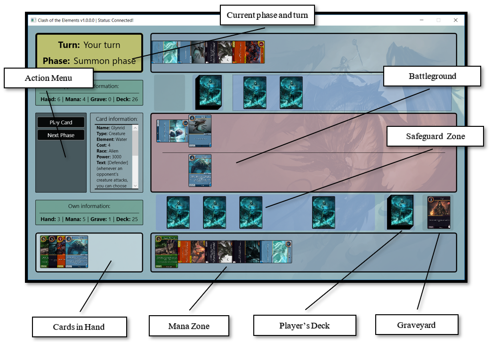

# Clash of the Elements, a 2D Online Trade Card Game

This app served as my ***degree project*** and was inspired by an old TCG called **Duel Masters** that people used to play with physical cards. It features cards of 2 types **creatures** and **spells** having special effects, used to destroy your opponent's **safeguards** and attack him one more time in order to win.

# Gameplay and Rules

## Goal

Each player starts the match protected by **5 safeguards**, which are face-down cards. Use your creatures and spells to break all of your opponent's safeguards, then land one more attack on your opponent to win.

## Key Terms

| Term | Meaning |
|---|---|
| Element | Every card belongs to one of five elements: **Air**, **Earth**, **Ether**, **Fire** or **Water** |
| Safeguards | Face-down cards that protect a player. A broken safeguard goes to its owner's hand |
| Battle zone | Where creatures are played and fight |
| Mana zone | Your resource pool, built from cards in your hand |
| Graveyard | Where destroyed creatures and used spells go |
| Engaged | A card that has been used this turn: spent mana, or a creature that attacked or blocked. It becomes ready again at the start of its owner's next turn |
| Summoning sickness | A creature can't attack on the turn it is played |

## Cards

There are two card types:

- **Creatures** stay in the battle zone and have **Power**, which decides who wins a battle.
- **Spells** have a one-time effect and then go to the graveyard.

Every card has an **element**, a **cost**, and may have one or more [abilities](#card-abilities).

## Deck Building

- A deck can have up to **40 cards**.
- You can include up to **4 copies** of the same card.

## Starting a Match

1. A random player is chosen to go first.
2. Both decks are shuffled.
3. Each player puts the top **5** cards of their deck face down as their safeguards.
4. Each player draws the next **5** cards as their opening hand.

## Turn Structure

Each turn goes through these phases in order. You can't go back to an earlier phase.

```
Start of turn ─► Mana phase ─► Summon phase ─► Attack phase ─► End of turn
```

### 1. Start of Turn

- All your engaged mana and creatures become ready again.
- Your creatures lose summoning sickness.
- You draw a card.

The player who goes first skips this step on their first turn, so **they don't draw on turn 1**.

### 2. Mana Phase

- You may put **one** card from your hand into your mana zone. Any card can be used as mana.
- This is optional, and you can skip straight to the Summon phase.

### 3. Summon Phase

- Play as many cards from your hand as you can pay for (see [Mana and Costs](#mana-and-costs)).
- Creatures enter the battle zone with summoning sickness.
- Spells take effect immediately and go to the graveyard at the end of the turn.

### 4. Attack Phase

Each of your creatures without summoning sickness may attack **once** per turn. Attacking engages the creature. For each attack, choose one:

- **Attack safeguards:** break one of your opponent's safeguards (some creatures break 2 at once). You choose which ones.
- **Attack a creature:** battle one of your opponent's **engaged** creatures. Ready creatures can't be attacked.
- **Attack the opponent:** only possible once your opponent has **no safeguards left**. If the attack isn't blocked, you win.

Some creatures have effects that happen whenever they attack. These take effect before your opponent can block.

#### Breaking safeguards

A broken safeguard goes into its owner's hand. If several break at once, the defending player chooses the order they are revealed in. If a broken card has **Safeguard Active**, its owner can instead play it immediately **for free**, even though it's the opponent's turn.

#### Blocking

When one of your creatures or safeguards, or you yourself, are attacked, you may block with one of your ready creatures that has **Defender**. The blocker battles the attacker instead, and blocking engages it. Some creatures can't be blocked.

### 5. End of Turn

Spells in play go to the graveyard and your opponent's turn begins. There is no hand size limit.

## Mana and Costs

To play a card with cost **N**, engage **N** cards in your mana zone. **At least one** of them must be the same element as the card you're playing; the rest can be any element.

*Example: a Fire card with cost 5 needs 5 ready mana cards, at least one of them Fire (e.g. 1 Fire + 4 Water).*

Mana cards stay in your mana zone unless an effect moves them. Engaged mana becomes ready again at the start of your next turn.

## Elements

Elements have no strengths or weaknesses against each other, so a battle only compares Power. An element only matters when paying costs: you need mana of a card's element to play it.

## Battles

- The creature with **higher Power wins**, and the loser is destroyed.
- On a **tie**, both creatures are destroyed.
- Power bonuses from **Bloodthirst** only apply while the creature is attacking.
- Some creatures change how a battle ends. For example, Araneidae always takes the other creature down with it.

A destroyed creature goes to its owner's graveyard, unless an effect sends it somewhere else.

## Winning the Game

You win when:

- one of your creatures makes an **unblocked attack on an opponent who has no safeguards**, or
- your opponent **surrenders**.

Running out of cards in your deck doesn't make you lose. If a player disconnects, the match ends without a win or loss being recorded.

## Card Abilities

| Ability | Effect |
|---|---|
| Defender | Can block attacks |
| Bloodthirst | Extra Power while attacking |
| Safeguard Active | Can be played for free when it's revealed from a broken safeguard |

Many cards also have their own effects, for example:

- drawing cards, destroying creatures, or returning cards to their owner's hand when played,
- effects that happen whenever the creature attacks,
- breaking 2 safeguards at once, or sending broken safeguards to the graveyard instead of the hand,
- being impossible to block, being unable to attack, or attacking the turn it's played.

Each card's text describes exactly what it does.

### Interface


# Building and running

#### Prerequisites
- Visual Studio (2015 or newer)

#### Compiling

You need to restore some NuGet packages before compiling. Follow these steps:

Open the **Package Manager Console** in Visual Studio:
- Tools -> Nuget Package Manager -> Package Manager Console

Execute:
```
PM> Install-Package NuGet.CommandLine
PM> nuget restore
```
Do that for both projects. Reopen the projects if neccessary.

Now you can build and run the projects.

#### Running the tests

Each solution has a test project (`DM - Client.Tests` and `DM - Server.Tests`). They need Visual Studio 2019 or newer and the .NET Framework 4.8 Developer Pack. Open a solution and run the tests from **Test -> Test Explorer**.

The server's `Integration` tests read the card database, so they also need SQL Server Express LocalDB, which the server uses as well.

# Contributing
Pull requests are welcome. For major changes, please open an issue first to discuss what you would like to change.

# Contact
Feel free to contact me via email - gabriel.pop@yandex.com

# License
- **[MIT license](http://opensource.org/licenses/mit-license.php)**
